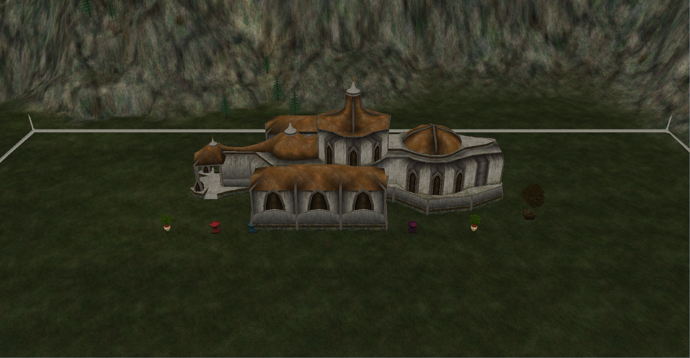
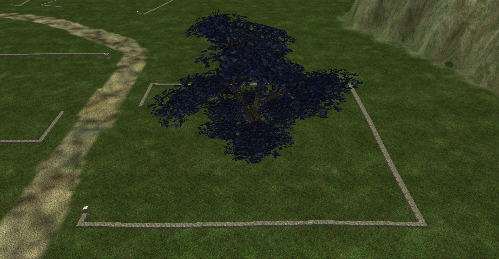
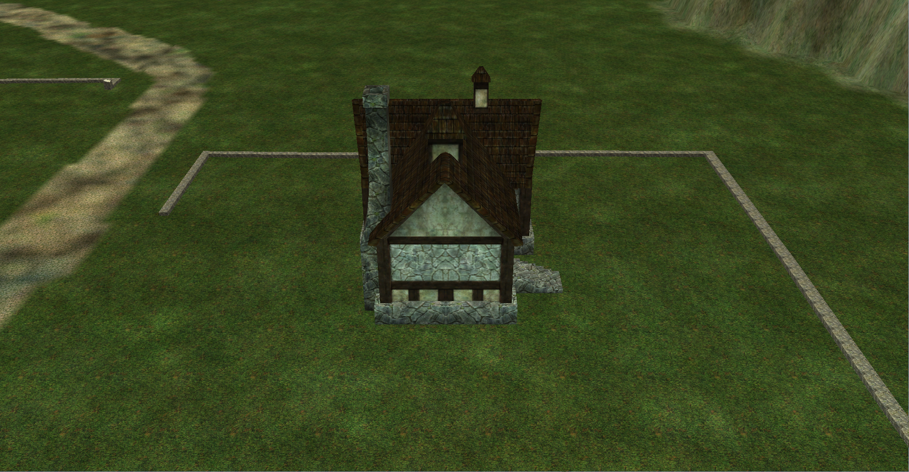
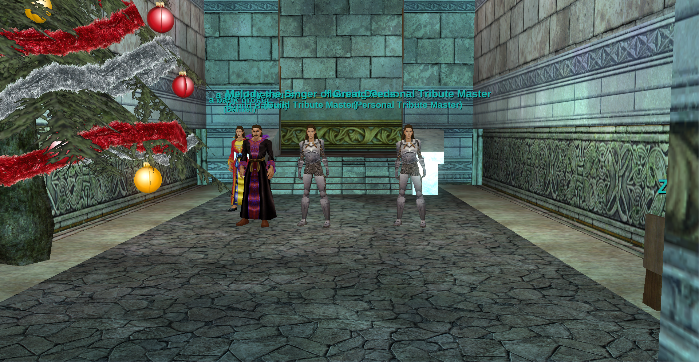

# EverQuest RoF2 Housing for EQEmu

Build a home, decorate a yard, and give your guild a place of its own. This project brings personal and guild housing to EQEmu using the **original May 10, 2013 Rain of Fear 2 client**.

**[Install or upgrade](docs/INSTALL.md)** · **[Housing opcodes & packet structures](protocol/README.md)** · **[Screenshots](#a-look-inside)** · **[Current status](docs/STATUS.md)**

*A Palatial Guild Hall on a neighborhood plot. Outdoor decorations can be arranged across the permitted plot area; furniture is not restricted to preset sockets. Plot boundaries, permissions and placement rules still apply.*

## What is included?

| Feature | What players can do |
| --- | --- |
| **Neighborhoods and plots** | Visit instanced Sunrise Hills, inspect plot markers, buy personal or guild plots, and pay upkeep. Fresh neighborhood setup includes 71 priced personal plots and four priced guild plots. |
| **Houses and guild halls** | Place supported buildings, enter their interiors, and keep their identity and contents through storage and moves. Guild Lobby routing connects owning guilds to their placed hall. |
| **Decoration** | Position, rotate and scale supported furniture outdoors or inside; mount supported items on walls and ceilings. Save and load layouts. |
| **Storage and moving** | Use closets/vaults, sheds and moving crates. Supported filled bags, augments and evolving-item identity/progress are retained. Property returns include parcel overflow. |
| **Guild services** | Place the reviewed banker, supply, tribute and teleport assistants. Pay the portal-crystal vendor and use the aligned teleport device. |
| **Ownership and upkeep** | Manage access, deposits, withdrawals, billing and voluntary Move Out. Reviewed retirement/recovery mechanisms preserve retained items. |

This is the **complete production housing package**: server source changes, ordered SQL migrations, content profiles, quest integration, opcodes and installation tools. Features are installed together; you do not need to assemble a collection of optional feature patches.

## Installing or upgrading your server

Choose the guide for the machine **running your server**. Playing EverQuest on Windows does not mean your server is a Windows server.

| Server setup | Your guide | Readiness |
| --- | --- | --- |
| **Linux, installed directly** | [Complete installation and upgrade guide](docs/INSTALL.md) | Representative original-client workflows and installation/rollback accepted |
| **AkkStack / Docker Compose** | [AkkStack step-by-step upgrade](docs/UPGRADE-AKK-STACK.md) | Uses the complete installer in the existing container layout; includes a Compose mount overlay |
| **Native Windows `.exe` server** | [Windows step-by-step upgrade](docs/UPGRADE-WINDOWS.md) | Native installer/build support implemented; full MSVC build and Windows gameplay acceptance still pending |

**Before starting:** have an existing EQEmu/MariaDB server, the matching original client, collision maps, and the build dependencies for your platform. The installer first prints a read-only plan, then takes private backups before applying changes.

The build uses a [pinned EQEmu source base](docs/INSTALL.md#source-compatibility-before-you-upgrade). Your custom C++ changes are not automatically merged. Read that compatibility section before replacing a customized server's binaries.

## Housing opcodes and structures are available

**You do not need to install the server to use the recovered protocol documentation.** This repository includes **67 documented housing-related opcode numbers**, **55 active mappings**, packet directions, field offsets, variable-length framing, and the C++ definitions/codecs used by the implementation.

- **[Start with the protocol guide](protocol/README.md)** — explains what each reference contains and how to read it.
- **[Opcode list](protocol/OPCODES.md)** — names, hexadecimal values and client/server directions.
- **[Packet structures](protocol/STRUCTS.md)** — sizes, offsets and message layouts.
- **[Machine-readable opcode records](protocol/opcodes.json)** and **[field dictionary](protocol/housing-wire-reference.json)** — useful for tools and further research.
- **[C++ housing source](overlay/common/housing/)** — wire definitions, codecs and server implementation.

Recovered values are tied to the original client build above. Active mappings, understood fields and implemented gameplay are different things; [protocol boundaries](protocol/PROTOCOL-BOUNDARIES.md) explains the remaining unknowns.

## A look inside

| Evantil's Abode | Hermit's Hideaway |
| --- | --- |
|  |  |
| A personal tree-house variant, shown in the original client. | A personal house variant with its own exterior and reviewed interior profile. |

*Furniture and reviewed NPC service contracts occupy the hall's interior. See [guild services and supported behavior](docs/STATUS.md) for the accepted scope. These are actual in-game captures, not concept art.*

## Helpful references

- [Current feature status](docs/STATUS.md) — what is implemented and what representative checks have passed.
- [Known limits](docs/KNOWN-GAPS.md) — unsupported item shapes, unavailable historical data and platform boundaries.
- [House and guild-hall item limits](docs/CONFIGURING-HOUSE-CAPACITIES.md) — researched capacities and labelled server defaults.
- [Implementation architecture](docs/ARCHITECTURE.md) — how the server components fit together.
- [Historical notes](docs/history/README.md) — detailed implementation history, kept separate from the installation steps.

This is a documented reconstruction, not a claim of complete 2013 Live equivalence. Unknown trophy benefits remain disabled. Client archives, private characters, credentials and verification suites are not distributed. The gallery contains screenshots only; installation imports the required geometry from **your own** matching client.
